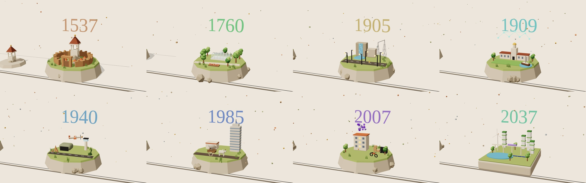

# Where does Bengaluru end? · 3D

The 3D version of the Digital Slider: a 5.8 m museum timeline with a 55" touch screen on rails, rebuilt as a miniature world in Three.js and told by Kempegowda's watchtower.

**Everything is in one file: `index.html`.** No build step. Open it in a modern desktop browser with an internet connection (Three.js and StringTune load from a CDN).

## The experience

- **One object per year.** At rest, each stop shows only its year and a single hero object, floating and turning gently.
- **The frame builds the memory.** Slide the frame over a year and the rest of the scene flies in piece by piece, tied to how far you have slid. Slide away and it leaves again.
- **The frame is a lens.** Outside it the world is a grey archive. Inside it, everything is in colour.
- **Restore 7 memories, unlock 2037.** Each completed memory earns a stamp. With all 7, you build the city you want on the last plot, and it stays at the end of the timeline.
- **Read the full story.** Scroll down at a stop, or click the scene, and the frame opens into a chapter page with live renders of that diorama.

A walkthrough video is in [`media/walkthrough.mp4`](media/walkthrough.mp4).

## Controls

- Drag anywhere to slide the frame, or use ← → keys and horizontal scroll
- Click another year's object to travel there, or click the current scene to read its story
- Scroll down at a stop to open the full chapter
- Design notes has a reviewer shortcut that grants all 7 stamps

## Links

- `#stop-1905` opens straight at a stop
- `#city-…` opens a city someone built

## Built with

- [Three.js](https://threejs.org) for the 3D world, with a two-pass render for the grey/colour lens
- [StringTune](https://www.npmjs.com/package/@fiddle-digital/string-tune) for smooth scrolling and magnetic buttons

The 2D version is in [`../digital-slider`](../digital-slider/).
