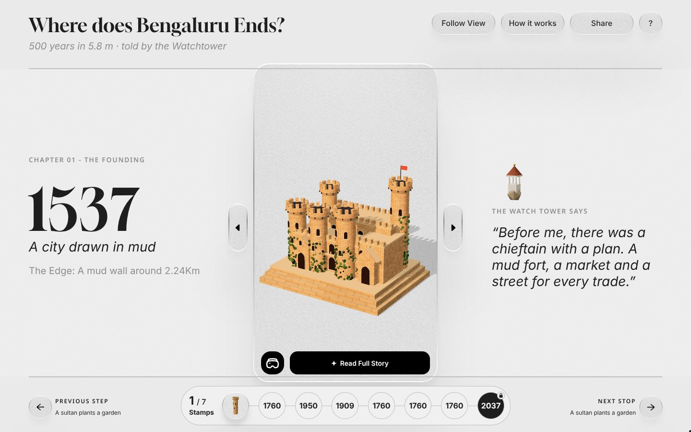
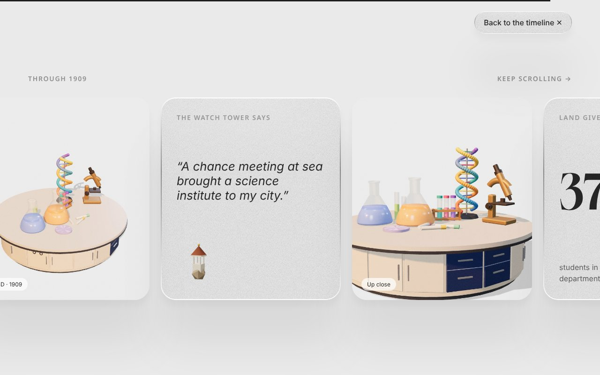

# Where does Bengaluru Ends? · Figma build

The digital slider museum timeline, built exactly from the Figma frame (1440 × 900) and narrated by Kempegowda's Watchtower. The glass card is the frame: drag it along the timeline and each year's 3D miniature builds itself and comes alive.

**Live:** https://jayashree676-gif.github.io/bangalore-city/digital-slider-figma/

## What it does

- **Drag the frame** anywhere on the scene, or use the side handles. Arrow keys work too.
- **One object per year.** When the frame lands on a stop, the rest of the scene flies in and starts to move: trains glide, the DNA model spins, flasks bubble, flags wave, trees sway.
- **Stamps.** Every restored scene adds a stamp to the timeline. 7 stamps unlock 2037, where you build your own city on the metro plot.
- **Read Full Story** opens the frame into a scrolling chapter (Lenis smooth scroll, GSAP ScrollTrigger: word-by-word reading, count-up numbers, pinned horizontal strip).
- **VR view** lets you look around the current scene. **Follow View** plays a guided tour.
- Responsive: the 1440 × 900 layout scales down to fit; below 1100px the page reflows into one column.

## Built with

- Three.js for the 3D scenes (golden-hour lighting, procedural brickwork), recreated from the reference renders for 1537, 1909 and 2037
- StringTune for magnetic buttons
- Lenis + GSAP ScrollTrigger for scrolling and scroll animations

## Files

- `index.html` is the whole site in one file. Open it in a browser (it loads Three.js, GSAP, Lenis and StringTune from jsdelivr).
- `src/` holds the editable source: `shell.html` (layout and CSS), `app.js` (3D and interaction), `renders.js` (reference renders). Run `python3 src/build.py` to rebuild `index.html`.

## Assets still to supply

The Watchtower character, the stamp image, the original grain texture and the Noe Display font were not available. Stand-ins are used (3D-rendered mascot and stamps, generated grain, Gloock). Paste the originals into the `ASSETS` slots at the top of `src/app.js` and rebuild.
